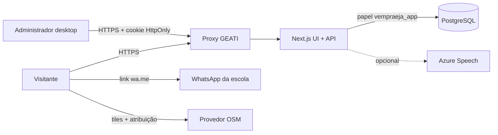

# Arquitetura técnica

## Decisão

A versão GEATI usa Next.js com Route Handlers e PostgreSQL convencional. O backend integrado substitui PostgREST, Supabase Auth e Edge Functions no caminho de produção. Essa escolha reduz o conjunto operacional de vários serviços do Supabase self-hosted para dois serviços permanentes (`app` e `db`), reaproveitando a interface React, o painel, o mapa, os filtros e a modelagem institucional já existentes.

A estrutura legada `supabase/` não foi apagada e permanece apenas como histórico. Ela não é carregada pelo app novo e nenhum dado antigo é importado: o PostgreSQL institucional começa sem escolas cadastradas.

## Componentes

### Contêineres

- `app`: imagem standalone e não-root; contém interface e API.
- `db`: PostgreSQL com volume nomeado e sem porta publicada.
- `migrate`: serviço efêmero com credencial proprietária; cria/atualiza o papel de aplicação e aplica migrations idempotentes.

## Substituição dos recursos Supabase

| Recurso anterior | Implementação GEATI |
|---|---|
| Supabase Auth | tabela de administradores, bcrypt e sessões opacas em cookie HttpOnly |
| PostgREST no navegador | Route Handlers same-origin e queries `pg` parametrizadas |
| RLS | banco não exposto + autorização obrigatória na API + papel de privilégio mínimo |
| Edge Functions de inscrição/e-mail | removidas; não existe pré-inscrição |
| Edge Function de analytics | endpoint local que incrementa somente linhas agregadas |
| Storage | não era necessário; URLs de imagens permanecem no cadastro institucional |
| Realtime | não utilizado |

## Modelo de segurança

O navegador não recebe senha de banco nem token de serviço. Login tem limite por combinação HMAC de endereço técnico e e-mail; a chave HMAC não é gravada como IP. A sessão usa token aleatório de 256 bits, cujo SHA-256 é o único valor persistido. Mutações exigem cookie válido, cabeçalho CSRF e `Origin` igual a `APP_ORIGIN`.

O papel do app pode manter escolas/turnos/auxílios, ler administradores e manter sessões, limites e métricas. Ele não acessa `schema_migrations` e não cria estrutura. A conta proprietária não é entregue ao contêiner da aplicação.

## Persistência e consistência

O banco vive no volume `postgres_data`. Salvar uma escola, seus turnos e auxílios ocorre em uma transação. Atualização de imagem não executa seed nem recria banco. Migrations possuem lock consultivo e registro próprio para impedir execução concorrente ou repetida.

Não há seed de escolas fictícias. O catálogo de auxílios também pode começar vazio e ser preenchido pelo administrador durante o cadastro das unidades.

## Escalabilidade e limites

O rate limit público é local a cada processo do app; isso é adequado ao deployment inicial de uma réplica. Se o GEATI escalar horizontalmente, deve mover o rate limit para um componente compartilhado. O tile público do OSM não possui SLA; para crescimento, adotar provedor contratado ou serviço próprio.
